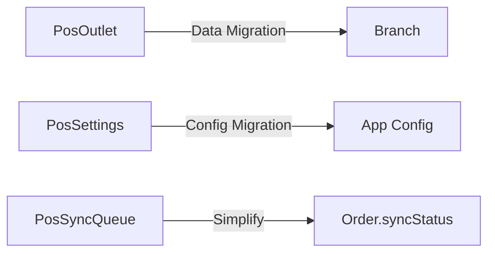

# Phase 6: Going Forward - Architecture & Maintenance Guide

## Overview
This document outlines the current architecture, design decisions, and future roadmap for the POS system integration.

---

## 🏗️ Current Architecture

### Authentication: **UNIFIED** ✅

```
┌─────────────────────────────────────────┐
│         Single Auth System              │
│                                         │
│  Cookie: auth-token                     │
│  Store: lib/user-store.ts              │
│  JWT Claims:                            │
│    - id, email, firstName, lastName     │
│    - role (customer/admin/super_admin)  │
│    - posRole (cashier/.../admin)        │
│    - permissions[]                      │
│    - assignedBranchId                   │
│                                         │
│  Used by:                               │
│    ✓ Web pages                          │
│    ✓ POS pages                          │
│    ✓ Admin pages                        │
│    ✓ API routes (via requireAuth,      │
│       requireAdmin, requirePosAccess)   │
└─────────────────────────────────────────┘
```

**Benefits:**
- Single source of truth
- Offline JWT validation
- Seamless role switching (admin can use both web and POS)
- Simplified maintenance

---

### Cart: **INTENTIONALLY SEPARATE** ⚠️

```
┌──────────────────────────┐  ┌──────────────────────────┐
│   E-Commerce Cart        │  │      POS Cart            │
│                          │  │                          │
│  lib/cart-store.ts       │  │  lib/pos/cart-store.ts   │
│                          │  │                          │
│  Features:               │  │  Features:               │
│  • Image selection       │  │  • Branch tracking       │
│  • Size/variant UI       │  │  • Vendor tracking       │
│  • Product grouping      │  │  • Line discounts        │
│  • Guest checkout        │  │  • Price overrides       │
│  • Wholesale detection   │  │  • Pricing modes         │
│  • Navigation slugs      │  │  • Minor-based math      │
│                          │  │  • Customer credit       │
│  Use case:               │  │  • Audit trails          │
│  Online shopping UX      │  │  • Multi-branch alerts   │
└──────────────────────────┘  └──────────────────────────┘
```

**Why Separate:**
1. **Different data models** - POS needs more fields (branchStockId, vendorId, priceOverrideReason, etc.)
2. **Different calculations** - POS uses minor-based math for financial precision
3. **Different business logic** - POS enforces multi-branch/vendor rules
4. **Different audit requirements** - POS tracks who added/modified each item
5. **Clearer codebase** - No "if POS then..." conditionals throughout

**Decision**: Keep separate, clearly labeled

---

### API Routes: **SEPARATED BY CONCERN**

```
/api/
├── auth/              ← Unified auth (web + POS login)
├── orders/            ← E-commerce orders
├── products/          ← Public product catalog
├── checkout/          ← Online checkout
├── admin/             ← Admin operations
│
└── pos/               ← POS-specific operations
    ├── auth/          ← POS login (uses unified auth internally)
    ├── branches/      ← Branch management
    ├── sales/         ← POS sales processing
    ├── held-orders/   ← Hold/resume orders
    ├── credit/        ← Customer credit operations
    ├── reports/       ← POS analytics
    ├── sync/          ← Offline sync
    └── ...            ← Other POS features
```

**Why Separate:**
- Different access control (requirePosAccess vs requireAuth)
- Different response formats (POS needs specific data structures)
- Offline support (POS routes handle sync queue)
- Branch-specific filtering
- Different audit logging

**Decision**: Keep separate, serves distinct use case

---

## 📊 Database Models

### Current Status

#### ✅ Modern Models (Use These)
- `Branch` - Locations with validation
- `BranchStock` - Inventory by branch
- `User` - With POS fields (posRole, assignedBranchId)
- `Order` - Supports both web and POS (channel field)
- `LedgerEntry` - Financial audit trail

#### ⚠️ Legacy Models (Still Used, To Be Migrated)
- `PosOutlet` - Old location model → migrate to Branch
- `PosSettings` - Config → move to app config
- `PosSyncQueue` - Offline sync → simplify
- `PosSyncConflict` - Conflict resolution
- `PosHeldOrder` - Held orders (keep)
- `PosAuditEntry` - Audit log (keep or merge with LedgerEntry)

#### Migration Strategy


**Timeline**: Not urgent - both work fine, migrate during maintenance window

---

## 🎯 Design Decisions

### Decision 1: Single Auth System ✅
**Rationale**: 
- Reduces complexity
- Enables offline support
- Allows role flexibility
- Industry best practice

**Trade-offs**: 
- Slightly larger JWT payload
- Must include POS claims for all admin users

**Verdict**: ✅ Correct decision, worth the trade-off

---

### Decision 2: Separate POS Cart ✅
**Rationale**:
- POS has fundamentally different requirements
- Financial precision needs
- Audit trail requirements
- Merging would bloat e-commerce cart

**Trade-offs**:
- Two cart implementations to maintain
- Cannot reuse cart components directly

**Verdict**: ✅ Correct decision, justified complexity

---

### Decision 3: Defer PosOutlet Migration ⏳
**Rationale**:
- Not blocking anything
- Requires careful data migration
- Both models work fine
- Can do during scheduled maintenance

**Trade-offs**:
- Some code references old model
- Two location models coexist

**Verdict**: ✅ Pragmatic decision, migrate when convenient

---

## 🔄 Future Roadmap

### Phase 7: API Consolidation (Optional)
**Timeline**: 3-6 months  
**Priority**: Low

**Goals**:
- Evaluate if any POS APIs can merge with main APIs
- Reduce duplicate endpoint patterns
- Maintain separation where justified

**Candidates for Consolidation**:
- ❓ `/api/pos/products/search` → add POS params to `/api/products`
- ❓ `/api/pos/categories` → use main categories API
- ❓ `/api/pos/customers` → merge with `/api/admin/customers`

**Keep Separate**:
- ✅ `/api/pos/sales` - unique POS logic
- ✅ `/api/pos/held-orders` - POS-only feature
- ✅ `/api/pos/sync` - offline support
- ✅ `/api/pos/reports` - POS-specific analytics

---

### Phase 8: Database Migration (When Ready)
**Timeline**: Next maintenance window  
**Priority**: Medium

**Steps**:
1. Create migration script
2. Test on staging environment
3. Schedule downtime (estimate: 30 minutes)
4. Run migration
5. Verify data integrity
6. Update code references
7. Deploy updated code
8. Monitor for issues

**Risk**: Medium (involves production data)  
**Mitigation**: Full backup + rollback plan + staging test

---

### Phase 9: Offline Enhancements (Future)
**Timeline**: 6-12 months  
**Priority**: Low

**Potential Improvements**:
- Progressive Web App (PWA) for POS
- Better conflict resolution UI
- Sync status dashboard
- Offline analytics
- Background sync optimization

---

## 📖 Maintenance Guide

### For New Developers

#### Adding a New POS Feature

1. **Authentication**
   ```typescript
   // In API route
   import { requirePosAccess } from '@/lib/auth'
   
   export async function POST(request: NextRequest) {
     const user = await requirePosAccess(request)
     // user has POS fields: posRole, assignedBranchId, permissions
   }
   ```

2. **Using POS Cart**
   ```typescript
   // In component
   import { usePosCartStore } from '@/lib/pos/cart-store'
   
   const { items, addItem, getTotalMinor } = usePosCartStore()
   ```

3. **Checking Permissions**
   ```typescript
   import { createPosPermissionChecker, POS_PERMISSIONS } from '@/lib/pos/permissions'
   
   const checker = createPosPermissionChecker(user)
   if (!checker.hasPosPermission(POS_PERMISSIONS.SALES_DISCOUNT)) {
     return error('Insufficient permissions')
   }
   ```

---

### Common Tasks

#### Task 1: Add New POS Permission
1. Edit `lib/pos/permissions.ts`
2. Add to `POS_PERMISSIONS` object
3. Update `posRolePermissions` mapping
4. Test with different roles

#### Task 2: Add Field to POS Cart
1. Edit `lib/pos/cart-store.ts`
2. Add to `PosCartItem` interface
3. Update `calcLineTotals` if financial
4. Update add/update methods
5. Test persistence

#### Task 3: Create New POS Report
1. Create route in `/api/pos/reports/[name]/route.ts`
2. Use `requirePosAccess()` for auth
3. Query with branch filtering if needed
4. Return summary + detail data
5. Create component in `/app/pos/reports/`

---

## 🐛 Troubleshooting

### Issue: "POS access denied"
**Cause**: User doesn't have POS role  
**Fix**: Admin must assign posRole to user in `/admin/pos/staff`

### Issue: "Cart cleared when switching branches"
**Cause**: Intended behavior (prevents multi-branch issues)  
**Fix**: None - warn users to complete sales before switching

### Issue: "Offline sales not syncing"
**Cause**: Network issue or sync queue full  
**Fix**: Check `/api/pos/sync` logs, retry sync manually

### Issue: "Session expired in offline mode"
**Cause**: JWT expired (24h limit)  
**Fix**: User must reconnect online and re-login

---

## 📚 Related Documentation

- [PHASE-4-CLEANUP-COMPLETED.md](./PHASE-4-CLEANUP-COMPLETED.md) - What was done
- [PHASE-5-TESTING-CHECKLIST.md](./PHASE-5-TESTING-CHECKLIST.md) - How to test
- `lib/auth.ts` - Auth implementation
- `lib/pos/permissions.ts` - Permission system
- `lib/pos/cart-store.ts` - POS cart logic
- `lib/pos/sale-service.ts` - Sale processing

---

## 🎓 Key Principles

### 1. Separation of Concerns
- Web and POS have different needs
- Don't force unification where it doesn't make sense
- Keep code paths clear and simple

### 2. Progressive Enhancement
- Online-first, offline-capable
- Graceful degradation
- Clear sync status

### 3. Audit Everything (POS)
- Who did what, when, why
- Financial transactions fully traceable
- Comply with retail regulations

### 4. Developer Experience
- Clear naming conventions
- Comprehensive error messages
- Documentation at decision points

---

## 💡 Best Practices

### DO ✅
- Use `requirePosAccess()` for all POS routes
- Check permissions before sensitive operations
- Log all financial transactions to ledger
- Test offline mode for new POS features
- Document why POS code differs from web

### DON'T ❌
- Don't try to merge POS and web carts
- Don't skip permission checks "for convenience"
- Don't forget to log to ledger
- Don't assume online connectivity
- Don't modify POS cart calculations without financial review

---

## 🚀 Performance Optimization

### Current Optimizations
- ✅ JWT validated locally for offline speed
- ✅ Product catalog cached in service worker
- ✅ Cart calculations done client-side
- ✅ Branch stock pre-filtered on server

### Future Optimizations
- [ ] Redis cache for frequent POS queries
- [ ] Product search index optimization
- [ ] Report pre-aggregation
- [ ] Websocket for real-time stock updates

---

## 🔐 Security Considerations

### Current Measures
- ✅ POS routes require authentication
- ✅ Permission system enforced
- ✅ Price overrides logged with reason
- ✅ JWT includes all necessary claims
- ✅ Offline JWT expires in 24h

### Best Practices
- Rotate JWT secret regularly
- Monitor failed login attempts
- Review audit logs for anomalies
- Restrict POS access to trusted devices
- Use HTTPS in production

---

## 📈 Monitoring & Metrics

### Key Metrics to Track
1. **POS Uptime** - % of time POS is accessible
2. **Offline Sales** - Number of sales made offline
3. **Sync Success Rate** - % of offline sales synced successfully
4. **Average Sale Time** - Time from login to receipt
5. **Permission Denials** - Failed access attempts
6. **Stock Accuracy** - Difference between system and actual stock

### Alerts to Configure
- Failed sync for > 10 sales
- Multiple failed logins from same user
- Price override without approval
- Stock discrepancy > 10%
- Offline mode > 24 hours

---

## 🎯 Success Metrics

### Phase 4-5 (Current)
- [x] Single auth system implemented
- [x] Zero breaking changes
- [x] Documentation complete
- [ ] All tests passing (pending Phase 5)

### Long-term Goals
- [ ] 99.9% POS uptime
- [ ] < 2 second average sale time
- [ ] Zero sync conflicts
- [ ] 100% stock accuracy
- [ ] Positive staff feedback

---

## 🤝 Contributing

### For Team Members
1. Read this document first
2. Run local tests before pushing
3. Update docs when changing POS logic
4. Ask if separating or merging code

### Code Review Checklist
- [ ] Auth uses unified system
- [ ] Permissions checked where needed
- [ ] Financial ops logged to ledger
- [ ] Offline mode considered
- [ ] Tests updated
- [ ] Docs updated

---

## 📞 Support

### Questions About:
- **Auth**: Check `lib/auth.ts` and `lib/user-store.ts`
- **Permissions**: Check `lib/pos/permissions.ts`
- **Cart**: Check `lib/pos/cart-store.ts`
- **Sales**: Check `lib/pos/sale-service.ts`
- **Sync**: Check `lib/pos/sync-manager.ts`

### Need Help?
- Review this document
- Check test cases
- Ask team lead
- Create GitHub issue

---

**Architecture Status**: ✅ Stable and Well-Documented  
**Next Review**: After Phase 5 testing  
**Last Updated**: Phase 4 completion  
**Maintainer**: Development Team
